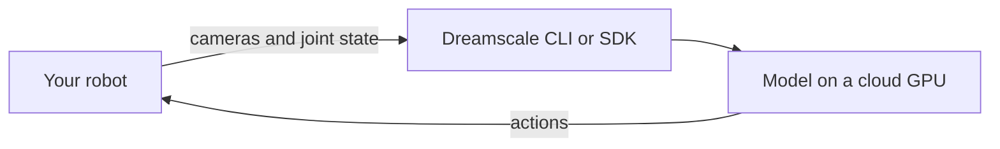

Your robot sends camera frames and joint state, and gets back the next actions
in real time. You don't need a local GPU or any model setup.

## Start here

<CardGroup cols={2}>
  <Card title="Quick start" icon="rocket" href="/quickstart">
    Install, sign in, and watch a model complete a task in simulation. No robot
    needed.
  </Card>
  <Card title="SO-101" icon="robot" href="/robots/so101">
    Set up a single SO-101 arm and run a model on it.
  </Card>
  <Card title="Bimanual YAM" icon="hands" href="/robots/yam">
    Set up two I2RT YAM arms and run a model on them.
  </Card>
  <Card title="Python SDK" icon="code" href="/python/run-a-policy">
    Call a model from your own robot code.
  </Card>
</CardGroup>

## How it works

- **Pick a model.** `dreamscale models` lists the models your organization can
  run. Each model is trained for a specific robot.
- **Start a session.** Dreamscale starts a GPU for you. The first connection
  can take a few minutes while the model loads.
- **Stream observations, get actions.** The CLI and SDK handle networking,
  buffering, and timing.
- **Pay per session.** Sessions bill per second from prepaid credits. Rates
  and your balance are on the [dashboard](https://app.dreamscalelabs.com/dashboard).

<Warning>
  Cloud inference does not replace your robot's safety controller. Keep joint
  and speed limits, a clear workspace, and a physical e-stop on every robot.
</Warning>

<Tip>
  Using a coding agent? Point it at
  [docs.dreamscalelabs.com/llms-full.txt](https://docs.dreamscalelabs.com/llms-full.txt)
  for these docs as one file.
</Tip>
